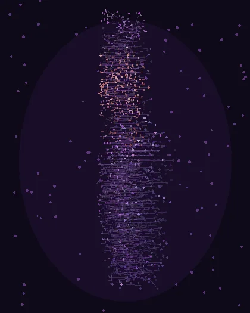
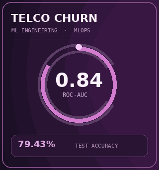
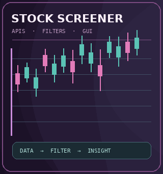
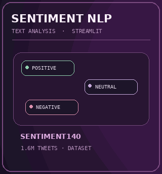
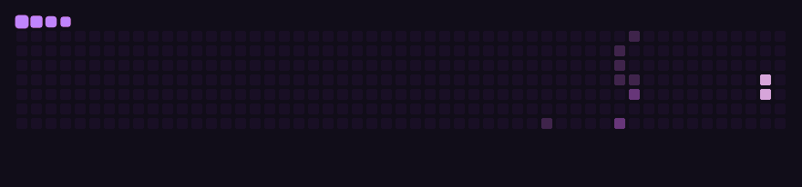
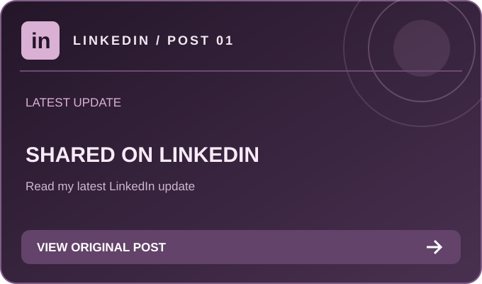
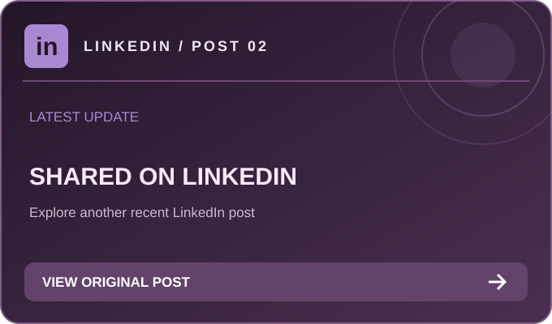

<!-- NIKHILNARSIPALLI — Animated GitHub Profile README
     Final concept: Option B editorial identity + flowing orbital network,
     point-cloud portrait, moving skill ribbon, and three featured project GIFs.
     No JavaScript runs on GitHub; all motion is contained in GIF images. -->

  

  
<strong>Python-focused Software Engineer · Backend Engineering · Applied AI/ML · Automation</strong>

  
  
  

## 👨‍💻 About Me

<table>
  <tr>
    <td width="66%" valign="middle">
      
Hey, I'm <strong>Nikhil</strong>! I build practical software at the intersection of <strong>backend engineering, applied AI/ML, and automation</strong>—from APIs and document-intelligence workflows to deployed machine-learning systems.

      
At <strong>EY GDS</strong>, I led a 3-member team as the lead technical contributor for selected AI-driven document-analysis PoCs using Python, Django/FastAPI, Azure OpenAI, and OpenCV. I also supported financial-services risk assessments, presented to UK/US stakeholders, and received <strong>three recognitions</strong>.

      
Before that, I worked on client-facing web/mobile applications and productivity automations during my year-long <strong>SDE internship at WAFU Technologies</strong>.

      
Outside code? <strong>3D printing, IoT, designing, hardware mechanisms, and prototyping</strong>—I love turning ideas into physical things.

    </td>
    <td width="34%" align="center" valign="middle">
      
    </td>
  </tr>
</table>

## 🚀 What I'm Building

<!-- PROJECTS:START -->
<table>
  <tr><td width="50%" valign="top"><a href="https://github.com/NIKHILNARSIPALLI/linkedin-desk"><strong>linkedin desk</strong></a> A local-first desktop workspace for researching, drafting, and approval-gated publishing of LinkedIn posts. Python</td><td width="50%"></td></tr>
</table>

## ✨ A Few of My Projects

  &nbsp;&nbsp;
  &nbsp;&nbsp;
  

  
<strong>Explore these featured builds</strong>

  **Telco Churn MLOps**  
  Built a FastAPI/scikit-learn ML service with MLflow, Docker, AWS deployment, CI/CD and monitoring. Evaluated 28 configurations across four classifiers.

  **Stocks Screening Application**  
  Python desktop screener using market-data APIs, scraping, configurable filters, and visual results. Animation shows conceptual, not live, market data.

  **Tweets Sentiment Prediction**  
  Sentiment140-based NLP sentiment classifier with a Streamlit interface. Animation is conceptual, not live inference.

<em>Project placement refreshes daily using each repository’s last public push date (30-day window).</em>

<!-- PROJECTS:END -->

<a href="https://github.com/NIKHILNARSIPALLI?tab=repositories"><strong>Browse all repositories</strong></a>

## 🧰 Engineering Toolkit

  

  
   
  

### Backend, languages & testing

-E34F26?style=flat-square&logo=html5&logoColor=white)
-1572B6?style=flat-square&logo=css&logoColor=white)

### Machine learning, data & NLP

### Applied AI, cloud & MLOps

### Apps, design, automation & hardware

  
Additional tools & working familiarity

  Familiar with **RAG, vector databases, document chunking, speech-to-text and text-to-speech workflows**. Other tool exposure includes **RobotStudio** and **Blue Prism**. Familiarity does not imply production ownership.

## 📊 GitHub Activity

  

  <a href="https://github.com/NIKHILNARSIPALLI?tab=overview"><strong>Explore my contribution history on GitHub</strong></a>

The animated snake refreshes through GitHub Actions. Public contributions do not represent the full scope of employment or private engineering work.

<!-- LINKEDIN:START -->
## 💬 Latest on LinkedIn

<em>Ideas, projects and lessons beyond the commit history. Click a tile to read the original post.</em>

<table>
<tr><td width="50%" align="center" valign="top"></td><td width="50%" align="center" valign="top"></td></tr>
</table>

<a href="https://www.linkedin.com/in/nikhilnarsipalli/recent-activity/all/">Explore more on LinkedIn</a>

<!-- LINKEDIN:END -->

---

  <strong>Beyond the Code:</strong> 3D Printing · IoT · Product Design · Automation · Hardware Mechanisms

  
<em>Curious by Nature. Engineer by Passion.</em>

